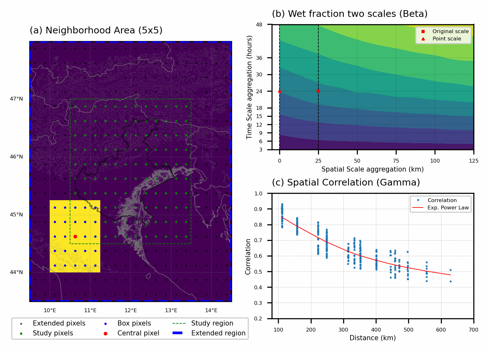

# Spatial Downscaling of Remote Sensing and Reanalysis (RSR) 

## Methodology

This methodology is based on the stochastic downscaling method proposed by [Zorzetto and Marani (2019)](#ref1), which transforms area-averaged precipitation statistics from RSR grid cells into an estimated point-scale precipitation distribution, with particular attention to extremes, and builds on the metastatistical approach to rainfall extremes proposed by [Marani and Ignaccolo (2015)](#ref2).

## Study Area

*This section is currently being updated.*

## Spatial Downscaling Approach

This approach links precipitation statistics at the satellite-grid scale to those at the point scale by using the scaling properties of rainfall fields. It uses two functions to account for changes in rainfall characteristics across spatial scales: the intermittency function, β, which describes how the wet fraction changes, and the variance-reduction function, γ, which describes how rainfall variance changes.

The functions β and γ are estimated from high-temporal-resolution rainfall data and the spatial correlation structure of each satellite dataset. They are then used to translate the parameters of the Weibull distribution of rainfall intensity from the satellite-grid scale to the point scale. Within the MEVD framework, the resulting point-scale Weibull parameters are used to estimate extreme precipitation statistics from satellite observations.

[Figure 1](#fig1) illustrates the procedure used to estimate β and γ for the Veneto region. The animation shows the neighborhood considered for a central pixel, the wet-fraction scaling used to estimate β, and the spatial correlation structure used to estimate γ.

<em>Figure 1. Illustration of the spatial downscaling procedure.</em>

The downscaling procedure is applied to one central pixel at a time (red dot in [Figure 1](#fig1)) and repeated across all pixels within the study region (green dashed outline). For pixels near the study-region boundary, the neighborhood used in the calculations extends beyond the study region (yellow box). We therefore define an extended region (blue outline) to include the additional surrounding pixels required for the downscaling procedure.

The procedure is applied independently to each pixel in the study area to produce spatial fields of β and γ. It is repeated for each rainfall dataset.

## RSR Data

*This section is currently being updated.*

## Acknowledgements and Code Attribution

The downscaling code in this repository is based on the work of Enrico Zorzetto, available in the [`downpy`](https://github.com/EnricoZorzetto/downpy) repository.

The original code was used as the basis for the downscaling implementation presented here and was updated and adapted to work with more recent software versions and the specific analyses presented in this study.

All other code, data processing procedures, analyses, and scripts contained in this repository were developed by the authors of this study.

The original `downpy` repository is distributed under the MIT License, and the original work of Enrico Zorzetto is acknowledged here accordingly.

Original repository: https://github.com/EnricoZorzetto/downpy

## References

[1] Marani M, Ignaccolo M (2015). *A Metastatistical Approach to Rainfall Extremes*. Advances in Water Resources, 79: 121–126. https://doi.org/10.1016/j.advwatres.2015.03.001

[2] Zorzetto, E. and Marani, M.: *Downscaling of rainfall extremes from satellite observations*, Water Resources Research, 55, 156–174, 2019. https://doi.org/10.1029/2018WR022950

